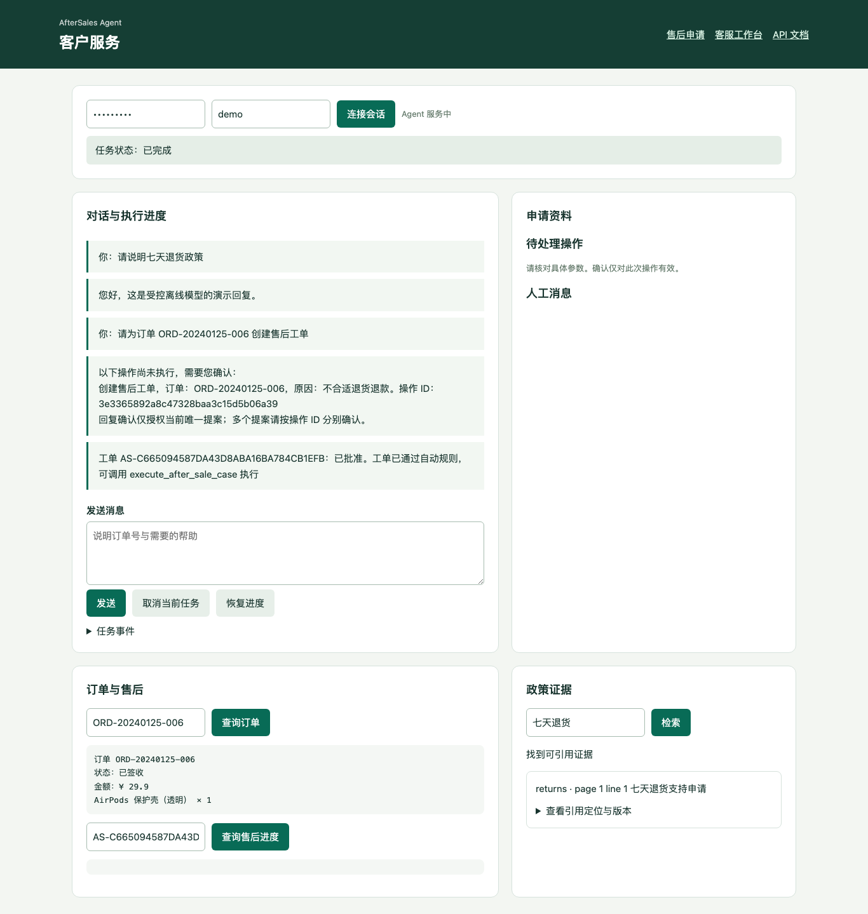
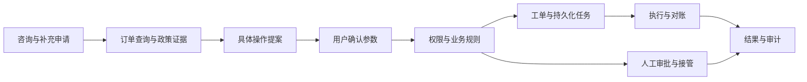

# AfterSales Agent｜电商售后智能体平台

[](https://github.com/scallion7/aftersales-agent/actions/workflows/offline-quality.yml)

AfterSales Agent 面向电商订单咨询与售后办理。顾客可以查询订单、核对政策原文，分轮补充售后申请，并在退货或换货操作执行前确认订单和参数。客服可以接管会话、审批工单，在退款结果未知时按原交易对账。

项目将模型推理与确定性业务执行分开：LLM 负责理解、规划和解释，服务端负责身份校验、操作确认、权限、幂等、状态转换与审计。演示使用合成业务数据和受控模型，可在本地复现 API、Worker、数据库、MCP 与浏览器之间的完整交互。

**当前项目聚焦系统搭建与技术挖掘**，交付 Agent、RAG、业务工作流、可靠执行、评测发布机制及可复现的工程验证。人工审核、真实模型效果评测和生产环境验证列为**后续自费验证，当前项目暂不涉及**；相关接口与操作说明作为扩展入口保留，详见[项目范围](docs/evaluation/acceptance.md#project-scope)。

[展示与面试](docs/showcase/README.md) · [分层教学](docs/learning/README.md) · [快速演示](docs/guides/five-minute-demo.md) · [系统架构](docs/architecture/overview.md) · [验收证据](docs/evaluation/acceptance.md) · [文档中心](docs/README.md)



*客户工作台演示使用合成订单及受控模型。截图中的政策引用和工单由本地 API 与 Worker 产生。*

## 业务流程



换货进入人工审核，由客服登记实际履约凭证后结案。修改或撤回申请会使关联的旧确认失效。政策上下文不足或证据冲突时，系统要求澄清或转人工；退款结果未知时进入对账，不通过换幂等键重复执行。

## 主要能力

| 能力 | 当前实现 | 阅读入口 |
|---|---|---|
| 身份与可信确认 | OIDC 身份绑定 issuer/sub；提案绑定用户、会话、参数与有效期，旧授权失效后重新提案 | [配置](docs/guides/configuration.md)、[可信执行](docs/engineering/reliable-execution.md) |
| 多轮售后办理 | 持久化申请草稿、字段来源、证据关联、修订冲突、撤回与同请求重试 | [售后申请](docs/guides/after-sale.md) |
| 可恢复执行 | SQL 幂等、租约 fencing、Outbox/Inbox、退款查询与有凭证的人工结案 | [执行与一致性](docs/engineering/reliable-execution.md)、[故障手册](docs/operations/incident-runbook.md) |
| 政策与知识治理 | 适用范围过滤、多轮上下文隔离、展示截断前的冲突检查、不可变知识快照与 CAS 发布 | [知识治理](docs/engineering/knowledge-and-governance.md) |
| 人工协作 | 所有权版本检查、接管后阻止新的自动调用、客服操作串行化与防重复回复 | [人工接管](docs/engineering/human-handoff.md) |
| 模型与配置治理 | 共享 token 额度、调用账本、发布门禁、会话版本固定 | [系统架构](docs/architecture/overview.md) |
| 评测与扩展 | 逐阶段检索诊断、审核审计、版本化数据、失败回流、预编译索引和队列准入 | [评测协议](docs/evaluation/offline-review.md)、[工程机制](docs/engineering/improvement-loop.md) |

技术栈：Python 3.10–3.12、FastAPI、Pydantic、SQLAlchemy/Alembic、SQLite/PostgreSQL、MCP Streamable HTTP、OpenTelemetry、Playwright、GitHub Actions。支持 ReAct、Plan-and-Execute 与多 Agent 路由。

## 快速启动

推荐 Python 3.11。先在项目父目录克隆仓库，进入 `aftersales-agent` 后创建虚拟环境并启动演示。

```bash
git clone https://github.com/scallion7/aftersales-agent.git
cd aftersales-agent
python3.11 -m venv .venv
source .venv/bin/activate
python -m pip install -r requirements-lock.txt
python -m app.scripts.demo_stack --intake --directory app/sessions/readme-demo
```

Windows PowerShell 将环境创建和激活两步替换为 `py -3.11 -m venv .venv` 与 `.venv\Scripts\Activate.ps1`。

启动器打印动态分配的本机地址：

| 页面 | 用途 | 演示令牌 |
|---|---|---|
| `/workspace` | 客户对话、任务进度、操作确认 | `demo-user` |
| `/after-sale` | 售后申请、资料修订与证据 | `demo-user` |
| `/workbench` | 人工接管、回复、审批与知识管理 | `demo-admin` |
| `/review` | 检索复核与数据集管理 | `demo-admin` |

启动器创建隔离数据库、执行迁移与种子导入，并启动 API、Worker、受控 HTTP 模型和库存 MCP。`--intake` 启用对话申请草稿，商务 Provider 使用本地 mock；独立 HTTP 退款沙箱见[配置指南](docs/guides/configuration.md)。退出时按 `Ctrl+C`，指定目录中的数据和日志保留。

演示无需真实模型密钥或 Docker，首次安装依赖需要网络。上述令牌仅用于本机演示。逐步操作与预期结果见[五分钟演示](docs/guides/five-minute-demo.md)。只验证启动和任务完成可运行：

```bash
python -m app.scripts.demo_stack --smoke --directory app/sessions/smoke-demo
```

## 验证与范围

改名后启用 Chromium，本地 **554 项回归全部通过，零跳过，app 语句覆盖率 84%**。[改名复验](docs/evaluation/acceptance.md#aftersales-agent-rename)

政策问答用 40 道新单轮题和 6 段对话的 17 轮复测，逐项符合预期的数量从 32/57 提高到 **57/57**。此前 16 道开发题与 32 道补充题仍在两份配置、四种检索模式下全部通过。换货回归同时核对工单、退款记录和待发送指令。[政策问答逐题对照](docs/evaluation/policy-transfer.md) · [政策同义问法](docs/evaluation/acceptance.md#policy-paraphrases-20261118) · [换货与会话恢复](docs/evaluation/acceptance.md#agent-boundaries-20261118)

本地验收覆盖数据库迁移与恢复、人工接管、令牌续签、退款超时查单、审批阈值固定和多进程日志清理。Agent 政策质量开发集包含 9 个业务家族：ReAct、Plan-and-Execute 和多 Agent 共 27 格，逐题校验关键事实、引用及转人工原因，并在临时目标库验证发布。详细结果见[当前验收](docs/evaluation/acceptance.md)。

[评测与发布指南](docs/evaluation/offline-review.md)提供创建草稿、指定知识快照、限额分批续跑、核验原件及切换配置的命令。当前使用受控模型验证这些机制；原 32 题人工审核、16 题保留集与真实模型评测归入后续自费验证。最近提交的 CI 状态见页首标记。

- 默认余弦检索与版本化 SQL 知识平台可用；Chroma 后端因未修复安全公告停用。
- 新平台表有租户作用域，但不能据此认为所有历史业务表已经支持共享数据库的 SaaS 多租户。
- 恢复验收覆盖隔离部署、停写 PostgreSQL 与独立沙箱；持续写入 PITR、跨区域恢复和生产 SLA 属于范围外的后续自费验证，当前没有相关验收证据。

## 简历展示与项目教学

项目适合展示 Agent 应用开发、业务执行可靠性和评测交付能力。介绍个人职责时按实际承担范围选择条目；验证结果保留对应的提交、环境与数据口径。

| 目的 | 入口与交付内容 |
|---|---|
| 快速了解项目 | [一页项目卡](docs/showcase/project-card.md)：业务问题、系统边界、关键设计与证据 |
| 准备简历 | [简历材料](docs/showcase/resume.md)：Agent 应用与 AI 后端两种侧重、可核对的贡献条目 |
| 准备面试 | [面试讲解](docs/showcase/interview.md)：3 分钟、10 分钟讲解和技术追问 |
| 现场演示或播放录像 | [三项演示](docs/showcase/demo.md)、[录制素材](docs/showcase/recording.md)：正常办理、退款未知恢复、评测拒绝发布 |
| 分层学习与授课 | [课程与实验](docs/learning/README.md)：基础、业务流程、可靠性三层，包含练习、验收与参考答案 |

课程使用当前代码的隔离实验。第 1–34 期仍作为[历史演进资料](docs/history/README.md)保留，历史命令不代替现行实验步骤。课程不要求开展范围外的自费验证。

## 代码与文档入口

| 位置 | 内容 |
|---|---|
| `app/agent/` | Agent 策略、工具契约、检索、记忆与业务技能 |
| `app/services/`、`app/repositories/` | 业务服务、可信执行与持久化 |
| `app/platform/` | 知识、模型预算、协作与评测平台 |
| `app/web/` | HTTP 接口及客户、客服、复核页面 |
| `app/scripts/` | 启动、迁移、评测、备份与恢复命令 |
| `tests/`、`.github/workflows/` | 回归测试与 CI |
| `docs/` | 当前指南、历史开发记录与原始验收证据 |

开发与部署分别见[配置与运行](docs/guides/configuration.md)、[部署清单](docs/operations/deployment-checklist.md)。阶段 1–34 和后续交付记录见[历史目录](docs/history/README.md)，历史命令和测试数保留其原始时点。

## 维护者

项目维护者：[scallion7](https://github.com/scallion7)。工程演进及提交依据见[项目演进](docs/CONTRIBUTIONS.md)。
